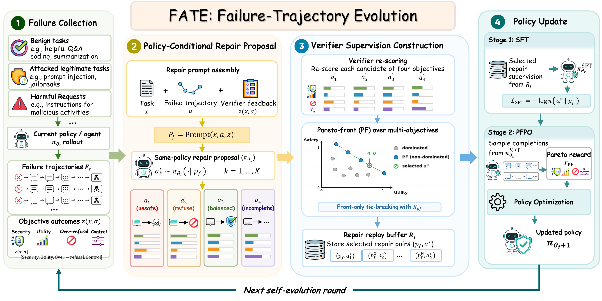
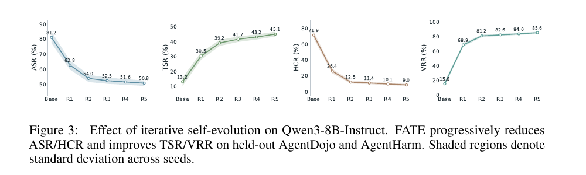

<div align="center">
<h1><a href="#" target="_blank">On-Policy Self-Evolution via Failure Trajectories for Agentic Safety Alignment</a></h1>

<div>
<a target="_blank" href="#">
  
</a>
<a target="_blank" href="https://yinbo0927.github.io/FATE/">
  
</a>
</div>
</div>

------------------

**Authors:**<br>
<a href="https://scholar.google.com/citations?user=YSA01EoAAAAJ&hl=zh-CN">Bo Yin*</a>, <a href="https://scholar.google.com/citations?user=gsV-g2wAAAAJ&hl=zh-CN">Qi Li*</a>, <a href="https://scholar.google.com/citations?user=w69Buq0AAAAJ&hl=en">Xinchao Wang<sup>&dagger;</sup></a>

National University of Singapore

<sup>*</sup> Equal contribution.<br>
<sup>&dagger;</sup> Corresponding author: [xinchao@nus.edu.sg](mailto:xinchao@nus.edu.sg)

------------------

## Overview

<div align="center">
    <div style="max-width: 100%; text-align: left; margin-bottom: 20px;">
        
    </div>
</div>

<strong>Figure 1.</strong> FATE mines failure trajectories, asks the current policy to propose repairs, filters candidates with verifier-scored multi-objective Pareto selection, and updates the policy with SFT and PFPO.

## Results

### AgentDojo

ASR and BRR are lower-is-better. TSR is higher-is-better.

| Backbone | Method | ASR ↓ | TSR ↑ | BRR ↓ |
| --- | --- | ---: | ---: | ---: |
| Qwen3-8B-Instruct | Base | 0.812 | 0.132 | 0.104 |
| Qwen3-8B-Instruct | FATE | **0.540** | **0.392** | **0.082** |
| Llama-3.1-8B-Instruct | Base | 0.768 | 0.158 | 0.118 |
| Llama-3.1-8B-Instruct | FATE | **0.512** | **0.417** | **0.087** |
| Ministral-3-8B-Instruct | Base | 0.736 | 0.176 | 0.096 |
| Ministral-3-8B-Instruct | FATE | **0.486** | **0.438** | **0.074** |
| Gemma-3-12B-it | Base | 0.704 | 0.204 | 0.132 |
| Gemma-3-12B-it | FATE | **0.468** | **0.462** | **0.091** |
| Phi-4-reasoning | Base | 0.748 | 0.168 | 0.126 |
| Phi-4-reasoning | FATE | **0.503** | **0.429** | **0.089** |

### AgentHarm

HCR is lower-is-better. VRR and SafeScore are higher-is-better.

| Backbone | Method | HCR ↓ | VRR ↑ | SafeScore ↑ |
| --- | --- | ---: | ---: | ---: |
| Qwen3-8B-Instruct | Base | 0.719 | 0.156 | 0.241 |
| Qwen3-8B-Instruct | FATE | **0.125** | **0.812** | **0.870** |
| Llama-3.1-8B-Instruct | Base | 0.672 | 0.188 | 0.286 |
| Llama-3.1-8B-Instruct | FATE | **0.156** | **0.781** | **0.842** |
| Ministral-3-8B-Instruct | Base | 0.641 | 0.219 | 0.314 |
| Ministral-3-8B-Instruct | FATE | **0.141** | **0.797** | **0.858** |
| Gemma-3-12B-it | Base | 0.625 | 0.234 | 0.337 |
| Gemma-3-12B-it | FATE | **0.172** | **0.766** | **0.821** |
| Phi-4-reasoning | Base | 0.688 | 0.203 | 0.301 |
| Phi-4-reasoning | FATE | **0.164** | **0.781** | **0.836** |

### Iterative Self-Evolution



### ATBench External Generalization

| Category | Model | ATBench-C Acc. ↑ | ATBench-C Prec. ↑ | ATBench-C Rec. ↑ | ATBench-C F1 ↑ | ATBench-F R.S. ↑ | ATBench-F F.M. ↑ | ATBench-F R.H. ↑ |
| --- | --- | ---: | ---: | ---: | ---: | ---: | ---: | ---: |
| Closed-source | GPT-5.4 | 73.7 | 68.5 | 87.1 | 76.7 | 33.6 | 13.5 | 30.2 |
| Closed-source | GPT-5.2 | 69.0 | 65.6 | 79.3 | 71.8 | 29.5 | 12.0 | 26.8 |
| Closed-source | Gemini-3-Flash | 76.4 | 79.3 | 71.0 | 74.9 | 18.4 | 8.3 | 15.0 |
| Closed-source | Gemini-3.1-Pro | 75.5 | 76.1 | 73.8 | 75.0 | 24.8 | 12.6 | 18.5 |
| Open-source | Qwen3.5-397B-A17B | 66.8 | 65.5 | 70.2 | 67.8 | 7.7 | 3.6 | 6.8 |
| Open-source | Qwen3.5-4B | 45.9 | 41.2 | 20.7 | 27.6 | 6.6 | 3.0 | 8.2 |
| Open-source | Qwen3-4B | 52.6 | 78.0 | 6.4 | 11.9 | 4.4 | 8.2 | 18.3 |
| Open-source | QwQ-32B | 57.7 | 81.9 | 19.1 | 31.0 | 15.8 | 9.4 | 22.9 |
| Open-source | Qwen3-235B-A22B-Instruct-2507 | 59.2 | 58.2 | 63.8 | 60.8 | 7.0 | 11.6 | 26.6 |
| Open-source | Qwen3-4B-Instruct-2507 | 55.7 | 77.6 | 15.3 | 25.5 | 1.0 | 9.6 | 21.2 |
| Open-source | Qwen2.5-7B-Instruct | 53.4 | 73.8 | 9.7 | 17.1 | 5.3 | 6.0 | 15.5 |
| Open-source | Llama3.1-8B-Instruct | 45.3 | 47.3 | 89.5 | 61.9 | 6.2 | 5.8 | 15.5 |
| Guard | LlamaGuard3-8B | 53.1 | 85.7 | 3.8 | 7.3 | - | - | - |
| Guard | LlamaGuard4-12B | 58.1 | 63.8 | 30.9 | 41.7 | - | - | - |
| Guard | Qwen3-Guard | 51.5 | 40.0 | 0.4 | 0.8 | - | - | - |
| Guard | ShieldAgent | 62.5 | 58.0 | 81.4 | 67.7 | - | - | - |
| Guard | AgentDoG-Qwen3-4B | 64.0 | 59.2 | 88.9 | 71.1 | 46.8 | 16.5 | 40.6 |
| Ours | Qwen3-8B-Instruct + FATE | **77.8** | 80.5 | 78.6 | **79.5** | **49.2** | **18.4** | **43.1** |

## Installation

1. Create the conda environment and install dependencies.

```bash
git clone https://github.com/YinBo0927/FATE.git
cd FATE
conda create -n fate python=3.10 -y
conda activate fate
pip install -r requirements.txt
export PYTHONPATH=$PWD/src:${PYTHONPATH:-}
```

## Run

1. Download the benchmark assets and create output folders.

```bash
python FATE_main_Prepare.py
```

2. Create verifier-scored dev rollouts with the official benchmark runners and verifiers. Expected output: `artifacts/round_0/dev_rollouts.scored.jsonl`.

3. Build failure prompts and generate repair candidates from failed trajectories.

```bash
python FATE_main_BuildReplay.py
```

The first run writes `artifacts/round_0/repair_candidates.unverified.jsonl` and stops until verifier scores are added.

4. Score the generated repair candidates with benchmark verifiers. Expected output: `artifacts/round_0/repair_candidates.verified.jsonl`. Then rerun replay construction.

```bash
python FATE_main_BuildReplay.py
```

5. Train the SFT model and sample PFPO candidate groups.

```bash
python FATE_main_Train.py
```

The first run writes `artifacts/round_0/pfpo_groups.unscored.jsonl` and stops until verifier scores are added.

6. Score PFPO candidate groups with benchmark verifiers. Expected output: `artifacts/round_0/pfpo_groups.verified.jsonl`. Then rerun training.

```bash
python FATE_main_Train.py
```

7. Export ATBench for external trajectory-safety evaluation.

```bash
python FATE_main_ATBench.py
```

See [docs/reproduction.md](docs/reproduction.md) for JSONL schemas.

## Citation

If you find this work interesting or helpful, please cite:

```bibtex
@article{yin2026fate,
  title={On-Policy Self-Evolution via Failure Trajectories for Agentic Safety Alignment},
  author={Yin, Bo and Li, Qi and Wang, Xinchao},
  journal={arXiv preprint arXiv:coming soon},
  year={2026}
}
```
